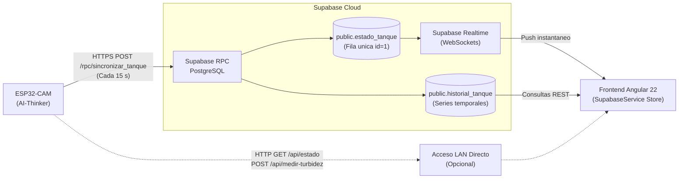

# Tanque Inteligente IoT - Frontend Web (Angular 22)

Estacion web de telemetria, control y monitoreo en tiempo real para el sistema de gestion de almacenamiento de agua potable basado en el microcontrolador **AI-Thinker ESP32-CAM**, conectado a la nube mediante **Supabase** y enfocado en la vigilancia sanitaria bajo normativa peruana (MINSA).

Proyecto desarrollado para el curso de **Arquitectura del Computador** en la **Universidad Privada del Norte (UPN Trujillo)**.

---

## 1. Descripcion General

Esta aplicacion web actua como la interfaz HMI / SCADA para visualizar el gemelo digital del tanque de agua. Permite supervisar niveles de reserva, litros disponibles, calidad fisica del agua por turbidez, estado de la tapa del contenedor, estimaciones de autonomia y deteccion temprana de fugas o estancamiento.

El diseno esta orientado a la precision tecnica de ingenieria, descartando patrones genericos para ofrecer una presentacion de datos densa, tipografia monoespaciada para mediciones de instrumentacion y compatibilidad nativa con dispositivos moviles y pantallas de escritorio.

---

## 2. Arquitectura de Datos y Flujo de Comunicacion



1. **Adquisicion en el Microcontrolador:** El ESP32-CAM muestrea el nivel con el sensor ultrasonico JSN-SR04T cada 10 s y la turbidez con el TS-300B en intervalos programados.
2. **Transmision Nube:** Cada 15 s, el ESP32 envia una carga util JSON estructurada a la funcion RPC atomica `sincronizar_tanque`.
3. **Persistencia y Distribucion:** La base de datos actualiza el estado unico (`estado_tanque`) y registra la serie temporal (`historial_tanque`).
4. **Consumo en Frontend:** La aplicacion Angular recibe actualizaciones en vivo via WebSockets (Supabase Realtime) sin recargar la pagina, contando con un respaldo de sondeo periodico configurable (polling).

---

## 3. Funcionalidades Principales

### Panel de Control (Dashboard)
- **Representacion grafica del tanque HMI:** Cilindro volumetrico con regla graduada lateral (marcas de calibracion para prototipo de 7 L o tanque real de 1100 L), cabezal con simulacion del haz acustico ultrasonico (JSN-SR04T), menisco fisico de llenado y sonda de turbidez inferior (TS-300B).
- **Lectura de instrumentacion fisica:**
  - Nivel hidraulico porcentual y volumen en litros.
  - Columna de agua neta y distancia medida por el sensor ultrasonico.
  - Turbidez fisica en Unidades Nefelometricas (UNT / NTU) con clasificacion cromatica.
  - Estado del sensor magnetico de tapa (MC-38) con contador de segundos de apertura.
  - Tasa de consumo instantaneo (L/h) y media ponderada diaria.
  - Proyeccion de dias de autonomia de reserva restantes.
  - Horas continuas de agua almacenada (control de estancamiento).
  - Tiempo de actividad del procesador Xtensa Dual-Core (Uptime).
- **Vigilancia sanitaria:** Panel tipo anunciador industrial con banderas deterministas segun el D.S. 031-2010-SA (Reglamento de la Calidad del Agua para Consumo Humano - MINSA).
- **Diagnostico en red local (LAN):** Capacidad de consultar `http://<IP_ESP32>/api/estado` o disparar una medicion forzada de turbidez via `/api/medir-turbidez` directamente desde la interfaz.

### Historial y Auditoria
- Registro cronologico de telemetria con selector de limite de muestras (10, 25, 50, 100).
- Resumen estadistico de nivel medio, turbidez media y conteo de alarmas.
- Formato responsivo dual:
  - **Escritorio:** Tabla tabular compacta con microbarras de nivel y chips de alerta.
  - **Movil:** Lista de tarjetas ergonomicas verticales para evitar desbordamiento horizontal.
- Adaptacion estricta al **huso horario de Peru (UTC-5, America/Lima)** en pantalla.
- Exportacion instantanea de registros a formatos **CSV** (con columna calculada de hora peruana) y **JSON**.

### Configuracion de Sistema
- Modificacion dinamica de credenciales de Supabase (URL y Anon Key).
- Ajuste de IP local del nodo ESP32 para comunicaciones en la misma subred.
- Selector de modo geometrico: Prototipo de laboratorio (Botella PET 7 L) o Tanque domestico (Rotoplas 1100 L).
- Herramientas de prueba de enlace en vivo (Ping LAN y comprobacion Supabase).

### Experiencia Movil (Mobile-First)
- Barra de navegacion inferior fija (`bottom-nav`) con objetivos tactiles ergonomicos (altura >= 48px).
- Integracion de margenes de seguridad para telefonos con muesca o barra gestual (`safe-area-inset-bottom`).
- Cuadricula fluida que se reorganiza de 2 columnas a 1 columna en pantallas pequenas.

---

## 4. Sensores y Pines del Hardware

El frontend refleja con fidelidad la instrumentacion fisica cableada en el modulo AI-Thinker ESP32-CAM:

| Sensor / Funcion | Pin ESP32 | Destino de Senal | Rol en la Interfaz |
| :--- | :--- | :--- | :--- |
| **JSN-SR04T (TRIG)** | GPIO12 | Disparo ultrasonico | Salida de pulso |
| **JSN-SR04T (ECHO)** | GPIO13 | Divisor 1k/2k (3.3V) | Nivel, litros y distancia neta |
| **TS-300B (AO)** | GPIO14 | ADC2_CH6 (Aislado de WiFi) | Turbidez en UNT y calidad del agua |
| **MC-38 (Reed)** | GPIO2 | Pullup interno contra GND | Deteccion de tapa abierta / cerrada |
| **LED Flash** | GPIO4 | Transistor MOSFET | Indicador fisico de alerta (opcional) |

---

## 5. Reglas Sanitarias Evaluadas (Normativa MINSA)

La interfaz procesa cinco condiciones criticas configuradas en el firmware:

| Alerta | Condicion Tecnica | Criterio Operacional y Sanitario |
| :--- | :--- | :--- |
| **Nivel Critico Bajo** | `porcentaje_nivel <= 20.0%` | Prevencion de desabastecimiento |
| **Tapa Abierta Prolongada** | `tapa_abierta && tiempo > 30 s` | Prevencion de ingreso del vector del Dengue (*Aedes aegypti*) |
| **Turbidez Excesiva** | `turbidez_ntu > 5.0 UNT` o `delta >= 2.5` | Limite maximo permisible fijado por el D.S. 031-2010-SA |
| **Sospecha de Fuga** | `tasa_consumo > 0.50 L/h` | Deteccion continua de roturas o goteos |
| **Agua Estancada** | `horas_almacenada >= 72 h (3 dias)` | Riesgo de proliferacion de biopeliculas bacterianas |

---

## 6. Pila Tecnologica

- **Framework:** [Angular 22](https://angular.dev/) (Standalone Components, Signals, Computed States).
- **Backend as a Service:** [Supabase](https://supabase.com/) (PostgreSQL, PostgREST RPC, Supabase Realtime via WebSockets).
- **Cliente Nube:** `@supabase/supabase-js` (v2.x).
- **Estilos:** CSS3 nativo con diseno SCADA industrial, tokens de diseno, tipografia monoespaciada y variables responsivas.
- **Pruebas Unitarias:** [Vitest](https://vitest.dev/) con `@angular/build:unit-test`.
- **Compilador y Bundler:** `@angular/build` (esbuild + Vite).

---

## 7. Requisitos Previos

- **Node.js:** Version 20.x o superior.
- **npm:** Version 10.x o superior.
- Navegador web moderno con soporte para WebSockets y CSS Grid (Chrome, Firefox, Edge, Safari).

---

## 8. Instalacion y Puesta en Marcha

1. **Clonar el repositorio:**
   ```bash
   git clone https://github.com/tu-usuario/frontend_tanque-inteligente.git
   cd frontend_tanque-inteligente
   ```

2. **Instalar dependencias:**
   ```bash
   npm install
   ```

3. **Iniciar el servidor de desarrollo:**
   ```bash
   npm start
   ```
   o directamente con Angular CLI:
   ```bash
   ng serve
   ```

4. **Acceder a la aplicacion:**
   Abre tu navegador en `http://localhost:4200/`.

---

## 9. Configuracion de Variables de Entorno

Los parametros predeterminados de conexion a Supabase y capacidades geometricas se encuentran en `src/environments/`:

```typescript
// src/environments/environment.ts
export const environment = {
  production: true,
  supabaseUrl: 'https://qdiscbtpsbvpbrndjsnb.supabase.co',
  supabaseAnonKey: 'sb_publishable_ZT_wFhxYrDnJgxucb-WBfQ_FDElItcX',
  esp32DefaultIp: '',
  tanquePrototipoCapacidadLitros: 7.0,
  tanqueRealCapacidadLitros: 1100.0,
  limiteMinsaTurbidezNtu: 5.0
};
```

> [!NOTE]
> Puedes actualizar o sobreescribir estas credenciales directamente desde la interfaz en la pestana **Ajustes**, donde los cambios quedan guardados de forma persistente en el almacenamiento local del navegador (`localStorage`).

---

## 10. Scripts Disponibles

En el directorio del proyecto puedes ejecutar:

- `npm start`: Inicia el servidor de desarrollo local en el puerto 4200.
- `npm run build`: Compila la aplicacion para produccion en el directorio `dist/frontend_tanque-inteligente`.
- `npm test`: Ejecuta las pruebas unitarias automatizadas con Vitest.
- `npm run watch`: Ejecuta la compilacion en modo observador con recarga incremental de desarrollo.

---

## 11. Estructura del Codigo Fuente

```text
src/
├── app/
│   ├── core/
│   │   ├── models/
│   │   │   └── tanque.model.ts          # Interfaces de telemetria, historial y configuracion
│   │   └── services/
│   │       ├── supabase.service.ts      # Cliente Supabase, Realtime WebSocket y polling
│   │       └── esp32-local.service.ts   # Comunicacion HTTP directa con el nodo en LAN
│   ├── features/
│   │   ├── dashboard/                   # Vista principal de monitoreo
│   │   │   ├── components/
│   │   │   │   ├── tank-gauge/          # Visualizador grafico del cilindro y menisco
│   │   │   │   ├── metric-card/         # Tarjetas de medicion con identificador de hardware
│   │   │   │   └── alerts-panel/        # Panel de alarmas sanitarias (D.S. 031-2010-SA)
│   │   │   ├── dashboard.component.ts
│   │   ├── history/                     # Vista de series temporales y exportacion CSV/JSON
│   │   │   ├── history.component.ts
│   │   └── settings/                    # Panel de configuracion de enlaces e IP LAN
│   │       ├── settings.component.ts
│   │   ├── app.routes.ts                # Enrutamiento lazy-loaded
│   │   ├── app.ts                       # Componente raiz
│   │   ├── app.html                     # Shell con barra superior y barra inferior movil
│   │   └── app.css                      # Estilos del contenedor y navegacion responsiva
│   ├── environments/                    # Configuraciones de entorno (prod y dev)
│   ├── index.html                       # HTML de entrada
│   ├── main.ts                          # Bootstrap de la aplicacion Angular
│   └── styles.css                       # Variables globales, paleta SCADA y tipografia
└── angular.json                         # Configuracion del CLI y presupuestos de empaquetado
```

---

## 12. Autores y Creditos

- **Institucion:** Universidad Privada del Norte (UPN) - Sede Trujillo.
- **Curso:** Arquitectura del Computador.
- **Desarrollo:** Carlitos Manuel Sanchez Ruiz y equipo del proyecto.
- **Licencia:** Proyecto academico de codigo abierto.
