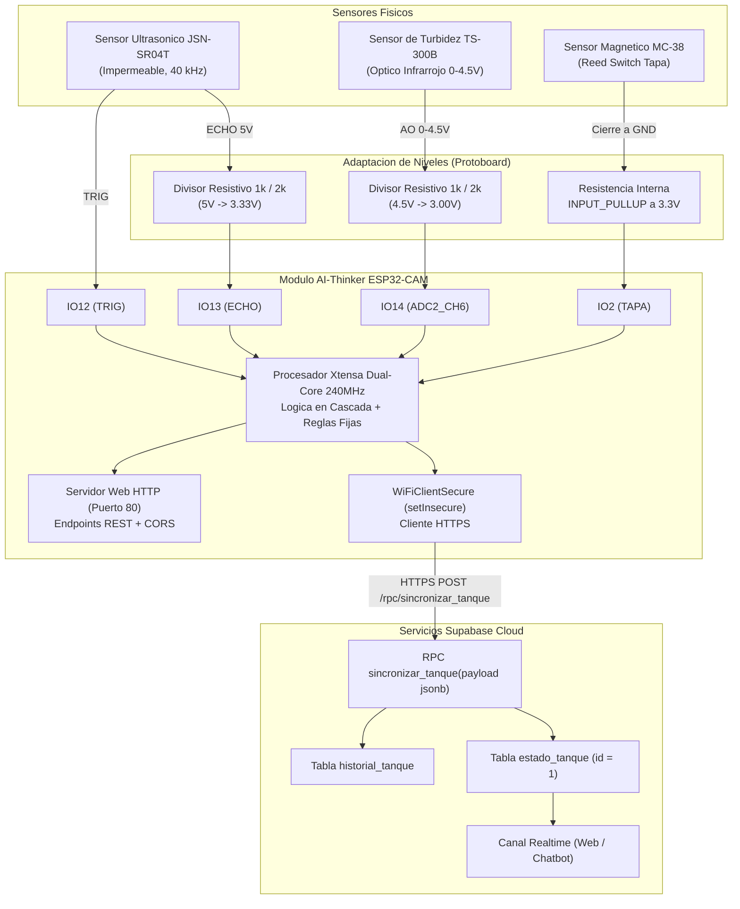
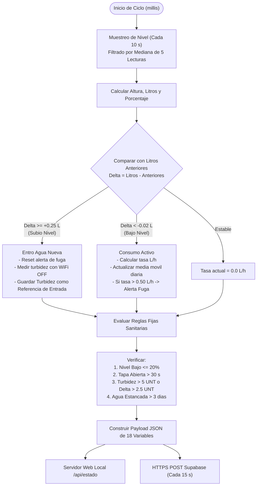

# Arquitectura del Sistema, Hardware y Circuitos

Este documento describe la arquitectura fisica, el diseno del circuito electronico y las consideraciones de hardware para el proyecto **Control de Tanque Inteligente con Chatbot de IA** implementado sobre el modulo **AI-Thinker ESP32-CAM**.

---

## Diagrama de Bloques General



---

## Modulo Principal: AI-Thinker ESP32-CAM

El sistema utiliza la tarjeta de desarrollo AI-Thinker ESP32-CAM montada sobre su base adaptadora CH340 con puerto micro-USB. 

### Caracteristicas de Operacion
- **Microcontrolador:** ESP32-D0WDQ6-V3 (Dual Core Xtensa 32-bit LX6 hasta 240 MHz).
- **Memoria RAM:** 520 KB SRAM interna + 4 MB PSRAM externa.
- **Memoria Flash:** 4 MB SPI Flash.
- **Conectividad:** Wi-Fi 802.11 b/g/n (hasta 150 Mbps) y Bluetooth v4.2 BR/EDR y BLE.

### Limitaciones de Pines GPIO y Asignacion
Dado que la placa integra la camara OV2640 y la ranura micro-SD, la cantidad de pines expuestos en los cabezales es reducida. La seleccion de pines requirio resolver compromisos de hardware:

1. **IO12 (Salida TRIG del sensor ultrasonico):**
   - Es un pin de arranque (*strapping pin*, MTDI). Si se encuentra en nivel HIGH durante el encendido o reset, fuerza el voltaje de la memoria flash a 1.8 V en lugar de 3.3 V, impidiendo el arranque del sistema (*boot loop*).
   - *Solucion de diseno:* El pin TRIG del modulo JSN-SR04T posee alta impedancia de entrada y el firmware fuerza `digitalWrite(PIN_JSN_TRIG, LOW)` inmediatamente en `setup()`.

2. **IO13 (Entrada ECHO del sensor ultrasonico):**
   - Es un pin digital estandar (GPIO13). No presenta restricciones de strapping. Recibe el pulso del eco tras pasar por el divisor de voltaje.

3. **IO14 (Entrada analogica de Turbidez):**
   - Corresponde al canal ADC2_CH6. En la arquitectura ESP32, el convertidor ADC2 es compartido con el hardware del transceptor WiFi. Mientras la radio WiFi transmite o recibe paquetes, las lecturas en ADC2 arrojan valores corruptos o fallan.
   - *Solucion de diseno:* El firmware aplica aislamiento por software: apaga brevemente la radio WiFi (`WiFi.mode(WIFI_OFF)`), promedia 20 muestras analogicas en reposo de radiofrecuencia y restaura inmediatamente el modo WiFi anterior.

4. **IO2 (Entrada del sensor magnetico de tapa):**
   - Es un *strapping pin* que debe permanecer en nivel bajo o flotante durante el arranque para no bloquear el modo de programacion.
   - *Solucion de diseno:* Se configura con `pinMode(PIN_MC38_TAPA, INPUT_PULLUP)`. Cuando la tapa esta cerrada, el reed switch conmuta a GND (nivel LOW). Si la tapa esta abierta, el pullup interno lo eleva a 3.3 V (HIGH).

5. **IO4 (LED Flash de alta potencia):**
   - Pin conectado al transistor MOSFET que controla el LED flash blanco integrado. Se mantiene en LOW por software para evitar consumo innecesario y calentamiento de la placa.

---

## Adaptacion de Niveles y Divisores de Voltaje

Tanto el sensor JSN-SR04T como el TS-300B se alimentan desde el riel de 5 V provisto por el regulador de la base adaptadora para operar dentro de sus curvas optimas. Sin embargo, las entradas del ESP32 toleran como maximo **3.3 V**. Superar este umbral provocaria la destruccion del circuito de proteccion interno del GPIO.

### Esquema del Divisor de Voltaje

```text
       Vin (Sensor 5V / 4.5V)
               │
               ┌┴┐
               │ │  R1 = 1 kOhm (1%)
               └┬┘
                ├───────────> Vout (Al Pin del ESP32 <= 3.3V)
               ┌┴┐
               │ │  R2 = 2 kOhm (1%)
               └┬┘
                │
               GND (Comun)
```

### Formula y Calculo Teorico

$$V_{out} = V_{in} \cdot \frac{R_2}{R_1 + R_2} = V_{in} \cdot \frac{2000}{1000 + 2000} = V_{in} \cdot \frac{2}{3}$$

El factor de escala inverso aplicado en el firmware para reconstruir la senal real del sensor es:

$$\text{FACTOR\_DIVISOR} = \frac{R_1 + R_2}{R_2} = \frac{3}{2} = 1.50$$

### Aplicacion por Sensor

1. **JSN-SR04T (Pin ECHO):**
   - Nivel logico alto del sensor: $V_{in} = 5.00\text{ V}$.
   - Nivel entregado al pin IO13: $V_{out} = 5.00 \cdot \frac{2}{3} = 3.33\text{ V}$ (seguro para logica CMOS 3.3V).

2. **TS-300B (Pin AO - Senal Analogica):**
   - Rango de salida del modulo: $V_{in} \in [0.00\text{ V}, 4.50\text{ V}]$.
   - Rango entregado al pin IO14 (ADC): $V_{out} \in [0.00\text{ V}, 3.00\text{ V}]$.
   - Dado que el convertidor analogico-digital del ESP32 tiene un fondo de escala de $3.30\text{ V}$ con atenuacion de 11 dB, la senal completa de turbidez entra comodamente dentro del rango dinamico lineal del ADC sin saturacion.

---

## Sensores del Sistema

### 1. Sensor Ultrasonico Impermeable JSN-SR04T
- **Transductor:** Transductor piezoelectrico sellado tipo campana (40 kHz) montado en la tapa del tanque.
- **Rango de medicion:** 25 cm hasta 450 cm.
- **Zona ciega:** 25 cm desde la superficie del transductor. En tanques o botellas pequenas, se debe asegurar que la distancia minima entre el sensor y el nivel maximo de agua no sea inferior a 25 cm (mediante un soporte elevador o cuello extensor).
- **Consumo de corriente:** 30 mA en operacion.

### 2. Sensor Optico de Turbidez TS-300B / TSW-30
- **Principio fisico:** Fotointerrupcion infrarroja. Un diodo emisor infrarrojo emite luz a traves de la muestra de agua hacia un fototransistor receptor. A mayor concentracion de particulas en suspension (turbidez), mayor dispersion y menor intensidad de luz alcanza al fototransistor, reduciendo el voltaje analogico entregado.
- **Voltaje de salida:**
  - Agua limpia / potable: $4.1\text{ V} - 4.5\text{ V}$ ($< 2.0\text{ UNT}$).
  - Agua medianamente turbia: $3.0\text{ V} - 4.0\text{ V}$ ($5\text{ UNT} - 50\text{ UNT}$).
  - Agua altamente turbia / residual: $\le 2.5\text{ V}$ ($> 3000\text{ UNT}$).

### 3. Sensor Magnetico de Tapa MC-38
- **Tipo de contacto:** Reed switch normalmente abierto (NO) accionado por campo magnetico permanente.
- **Montaje:** La parte con cables se fija al borde superior de la boca del tanque (cableada a IO2 y GND); la pieza con el iman permanente se adhiere a la tapa movil.
- **Comportamiento:**
  - Tapa cerrada: Iman alineado, contacto cerrado hacia GND -> Lectura en IO2 = `LOW`.
  - Tapa retirada o abierta: Contacto abierto, la resistencia `INPUT_PULLUP` eleva el pin a 3.3 V -> Lectura en IO2 = `HIGH`.

---

## Logica en Cascada del Sistema

El firmware implementa un bucle de control no bloqueante basado en eventos temporales y de nivel:


