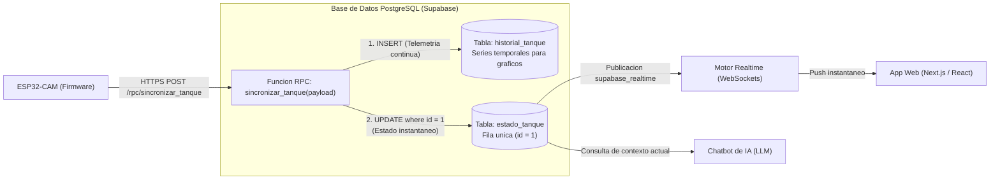

# Esquema de Base de Datos y Supabase

Este documento describe el modelo de datos, la logica de persistencia atomica y la configuracion de seguridad implementada en **Supabase** (PostgreSQL / PostgREST / Realtime) para el proyecto **Control de Tanque Inteligente con Chatbot de IA**.

---

## Arquitectura de Persistencia en la Nube

Supabase actua como la capa de persistencia y distribucion en tiempo real del sistema:



---

## Modelo de Tablas Relacionales

### 1. Tabla de Historial: `public.historial_tanque`
Almacena una serie temporal inmutable de cada muestra transmitida por el ESP32 (cada 15 segundos). Se utiliza para graficar la evolucion de nivel, consumo historico y auditoria sanitaria.

```sql
create table if not exists public.historial_tanque (
    id bigint generated always as identity primary key,
    created_at timestamptz default now() not null,
    
    -- Variables fisicas clave
    distancia_cm numeric(5,2) not null,
    altura_agua_cm numeric(5,2) not null,
    litros_disponibles numeric(6,2) not null,
    porcentaje_nivel numeric(4,1) not null,
    turbidez_ntu numeric(6,2) not null,
    tapa_abierta boolean not null,
    
    -- Consumo y proyeccion
    tasa_consumo_l_h numeric(6,2) not null,
    dias_autonomia numeric(5,2) not null,
    horas_almacenada numeric(6,2) not null,
    
    -- Banderas de alertas deterministas
    alerta_nivel_bajo boolean not null,
    alerta_tapa_abierta boolean not null,
    alerta_turbidez_alta boolean not null,
    alerta_fuga boolean not null,
    alerta_estancada boolean not null
);

create index idx_historial_created_at on public.historial_tanque (created_at desc);
```

#### Descripcion de Columnas
- `id`: Identificador unico secuencial autoincremental de 64 bits.
- `created_at`: Marca de tiempo UTC registrada automaticamente por el servidor al momento de la insercion.
- `distancia_cm`: Distancia directa del sensor al espejo de agua ($0.00\text{ a }999.99\text{ cm}$).
- `altura_agua_cm`: Columna neta de agua calculada ($0.00\text{ a }999.99\text{ cm}$).
- `litros_disponibles`: Volumen almacenado actual ($0.00\text{ a }9999.99\text{ L}$).
- `porcentaje_nivel`: Porcentaje de llenado ($0.0\%\text{ a }100.0\%$).
- `turbidez_ntu`: Turbidez del agua en Unidades Nefelometricas ($0.00\text{ a }9999.99\text{ UNT}$).
- `tapa_abierta`: Estado binario de la tapa (`true` = abierta, `false` = cerrada).
- `tasa_consumo_l_h`: Flujo de consumo calculado en litros por hora.
- `dias_autonomia`: Dias estimados de reserva restantes (acotado a 999.0 por el firmware para proteger el tipo `numeric(5,2)`).
- `horas_almacenada`: Horas transcurridas desde el ultimo llenado de agua fresca.
- Banderas `alerta_*`: Indicadores booleanos calculados por las reglas fijas del microcontrolador.

---

### 2. Tabla de Estado Actual: `public.estado_tanque`
Tabla de registro unico (*single-row table*) que representa el estado en vivo del tanque. La aplicacion web consulta esta tabla para renderizar los indicadores actuales y el Chatbot de IA la toma como fuente de verdad para sus respuestas.

```sql
create table if not exists public.estado_tanque (
    id int primary key check (id = 1),
    updated_at timestamptz default now() not null,
    modo_prototipo boolean not null default true,
    uptime_seg bigint not null default 0,
    
    -- Mediciones
    distancia_cm numeric(5,2) not null,
    altura_agua_cm numeric(5,2) not null,
    litros_disponibles numeric(6,2) not null,
    porcentaje_nivel numeric(4,1) not null,
    turbidez_ntu numeric(6,2) not null,
    turbidez_referencia_ntu numeric(6,2) not null,
    tapa_abierta boolean not null,
    segundos_tapa_abierta bigint not null default 0,
    
    -- Autonomia
    dias_autonomia numeric(5,2) not null,
    consumo_promedio_diario_l numeric(6,2) not null,
    tasa_consumo_l_h numeric(6,2) not null,
    horas_almacenada numeric(6,2) not null,
    
    -- Alertas
    alerta_nivel_bajo boolean not null,
    alerta_tapa_abierta boolean not null,
    alerta_turbidez_alta boolean not null,
    alerta_fuga boolean not null,
    alerta_estancada boolean not null,
    
    -- Recomendacion para el Chatbot
    recomendacion_sugerida text not null
);
```

#### Restriccion de Fila Unica
La clausula `check (id = 1)` impide la creacion de multiples filas, forzando a que cualquier actualizacion modifique siempre el mismo estado global.

#### Registro Inicial Semilla
Se asegura la existencia de la fila 1 para que las operaciones de actualizacion nunca fallen:

```sql
insert into public.estado_tanque (
    id, distancia_cm, altura_agua_cm, litros_disponibles, porcentaje_nivel,
    turbidez_ntu, turbidez_referencia_ntu, tapa_abierta, dias_autonomia,
    consumo_promedio_diario_l, tasa_consumo_l_h, horas_almacenada,
    alerta_nivel_bajo, alerta_tapa_abierta, alerta_turbidez_alta,
    alerta_fuga, alerta_estancada, recomendacion_sugerida
) values (
    1, 0, 0, 0, 0, 0, 0, false, 0, 0, 0, 0,
    false, false, false, false, false, 'Sistema iniciado'
) on conflict (id) do nothing;
```

---

## Procedimiento Almacenado RPC: `sincronizar_tanque`

La sincronizacion se ejecuta a traves de una funcion PL/pgSQL con privilegios `security definer`. Esto garantiza que la insercion en el historial y la actualizacion del estado actual se realicen en una sola transaccion atomica:

```sql
create or replace function public.sincronizar_tanque(payload jsonb)
returns void
language plpgsql
security definer
as $$
declare
    m jsonb := payload->'mediciones';
    a jsonb := payload->'autonomia_y_consumo';
    r jsonb := payload->'alertas_reglas_fijas';
    c jsonb := payload->'contexto_chatbot';
begin
    -- A) Guardar en el historico (Insert)
    insert into public.historial_tanque (
        distancia_cm, altura_agua_cm, litros_disponibles, porcentaje_nivel,
        turbidez_ntu, tapa_abierta, tasa_consumo_l_h, dias_autonomia,
        horas_almacenada, alerta_nivel_bajo, alerta_tapa_abierta,
        alerta_turbidez_alta, alerta_fuga, alerta_estancada
    ) values (
        (m->>'distancia_sensor_cm')::numeric,
        (m->>'altura_agua_cm')::numeric,
        (m->>'litros_disponibles')::numeric,
        (m->>'porcentaje_nivel')::numeric,
        (m->>'turbidez_actual_ntu')::numeric,
        (m->>'tapa_abierta')::boolean,
        (a->>'tasa_consumo_actual_l_h')::numeric,
        (a->>'dias_restantes_estimados')::numeric,
        (a->>'horas_agua_almacenada')::numeric,
        (r->>'nivel_bajo')::boolean,
        (r->>'tapa_abierta_prolongada')::boolean,
        (r->>'turbidez_alta')::boolean,
        (r->>'posible_fuga')::boolean,
        (r->>'agua_estancada')::boolean
    );

    -- B) Actualizar el estado actual unico (Update id = 1)
    update public.estado_tanque set
        updated_at = now(),
        modo_prototipo = (payload->>'modo_prototipo_7L')::boolean,
        uptime_seg = (payload->>'uptime_seg')::bigint,
        distancia_cm = (m->>'distancia_sensor_cm')::numeric,
        altura_agua_cm = (m->>'altura_agua_cm')::numeric,
        litros_disponibles = (m->>'litros_disponibles')::numeric,
        porcentaje_nivel = (m->>'porcentaje_nivel')::numeric,
        turbidez_ntu = (m->>'turbidez_actual_ntu')::numeric,
        turbidez_referencia_ntu = (m->>'turbidez_referencia_entrada_ntu')::numeric,
        tapa_abierta = (m->>'tapa_abierta')::boolean,
        segundos_tapa_abierta = (m->>'segundos_tapa_abierta')::bigint,
        dias_autonomia = (a->>'dias_restantes_estimados')::numeric,
        consumo_promedio_diario_l = (a->>'consumo_promedio_diario_litros')::numeric,
        tasa_consumo_l_h = (a->>'tasa_consumo_actual_l_h')::numeric,
        horas_almacenada = (a->>'horas_agua_almacenada')::numeric,
        alerta_nivel_bajo = (r->>'nivel_bajo')::boolean,
        alerta_tapa_abierta = (r->>'tapa_abierta_prolongada')::boolean,
        alerta_turbidez_alta = (r->>'turbidez_alta')::boolean,
        alerta_fuga = (r->>'posible_fuga')::boolean,
        alerta_estancada = (r->>'agua_estancada')::boolean,
        recomendacion_sugerida = coalesce(c->>'recomendacion_sugerida', '')
    where id = 1;
end;
$$;
```

---

## Politicas de Seguridad y Permisos (RLS)

Se habilita la seguridad por filas (*Row Level Security*) para restringir operaciones arbitrarias sobre las tablas directas, permitiendo acceso publico controlado para la aplicacion y otorgando permisos de ejecucion para la clave publica (`anon`):

```sql
-- 1. Habilitar RLS en ambas tablas
alter table public.historial_tanque enable row level security;
alter table public.estado_tanque enable row level security;

-- 2. Politicas de lectura e insercion publica
create policy "Lectura e insercion publica historial"
on public.historial_tanque for all using (true) with check (true);

create policy "Lectura y actualizacion publica estado"
on public.estado_tanque for all using (true) with check (true);

-- 3. Otorgar ejecucion de la funcion RPC a los roles publicos y autenticados
grant execute on function public.sincronizar_tanque(jsonb) to anon, authenticated;
```

---

## Publicacion Realtime para la Aplicacion Web

Para que la aplicacion web (ej. Next.js / React) o el asistente conversacional reciban inmediatamente los cambios sin necesidad de hacer sondeo periodico (*polling*), se incorpora la tabla `estado_tanque` a la publicacion de Supabase Realtime:

```sql
alter publication supabase_realtime add table public.estado_tanque;
```

### Ejemplo de Consumo en Cliente Frontend (TypeScript)

```typescript
import { createClient } from '@supabase/supabase-js';

const supabase = createClient(
  'https://qdiscbtpsbvpbrndjsnb.supabase.co',
  'TU_SUPABASE_ANON_KEY'
);

// Suscripcion a cambios en tiempo real en la fila id = 1
const canal = supabase
  .channel('cambios-estado-tanque')
  .on(
    'postgres_changes',
    {
      event: 'UPDATE',
      schema: 'public',
      table: 'estado_tanque',
      filter: 'id=eq.1'
    },
    (payload) => {
      console.log('Nuevo estado recibido del ESP32:', payload.new);
    }
  )
  .subscribe();
```
